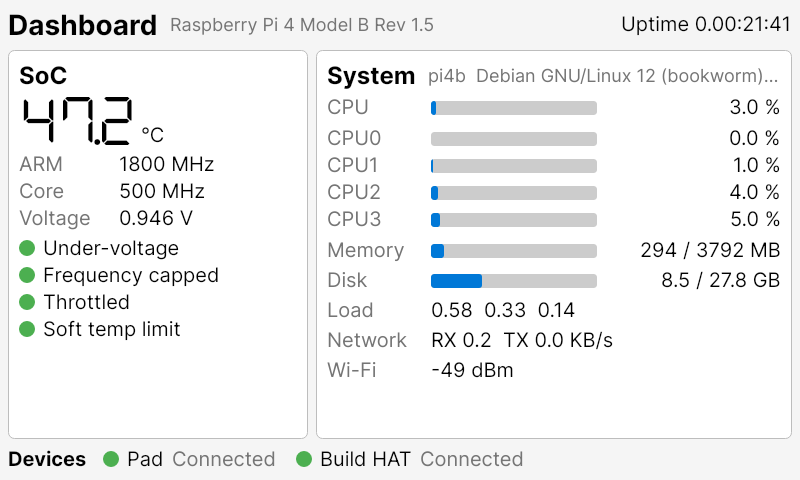
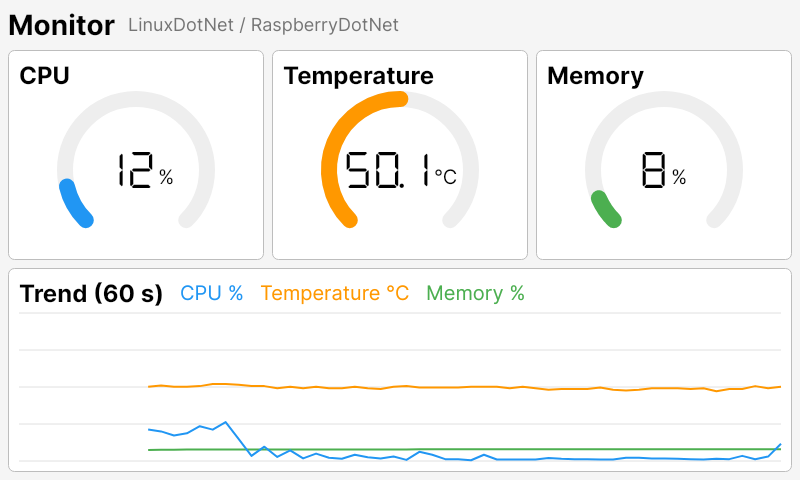
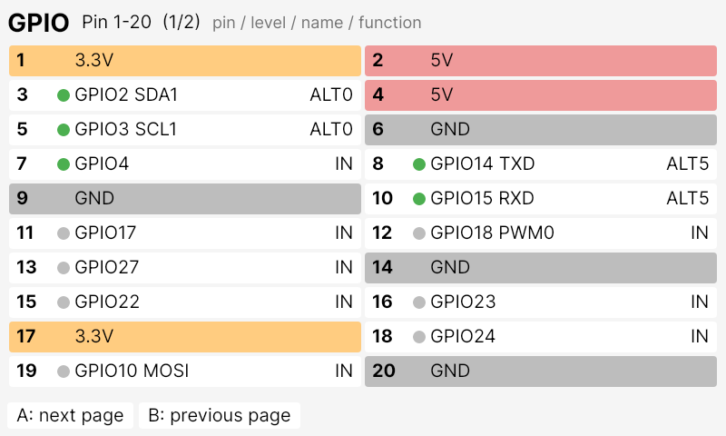
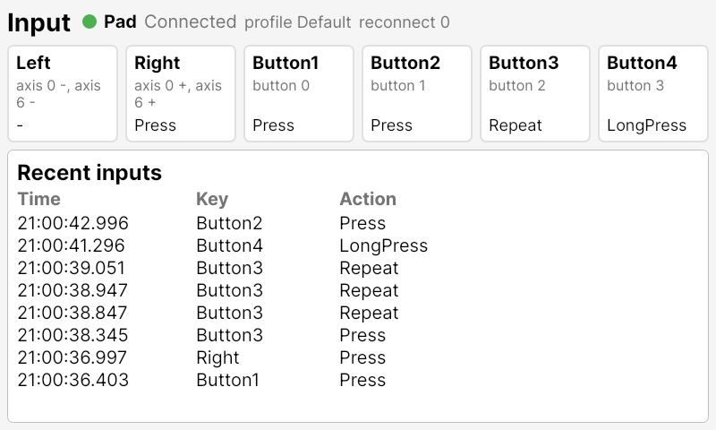
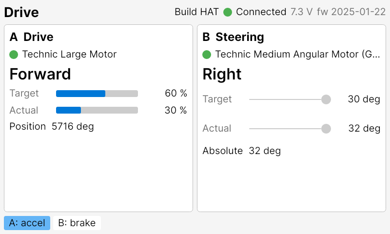
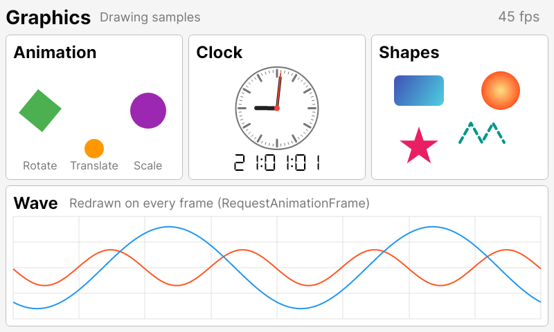
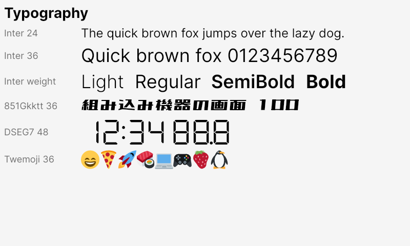

# template-avalonia-embedded

English | [日本語](README.ja.md)

Avalonia app template for Raspberry Pi embedded devices.

## 🖥️ Screens

- SoC temperature, clock, voltage, and throttling
- CPU, memory, disk, network, Wi-Fi, and device status

- Gauges for CPU, temperature, and memory with a 60-second trend

- Function and level of each pin on the 40-pin header, paged 20 pins at a time

- Pad connection status, and the press state, assignment, and last action of each key
- Recent input (press, long press, repeat)

- Speed and steering with the Build HAT

- Animation, analog clock, shapes, a waveform drawn every frame, and fps

- Various fonts and emoji
